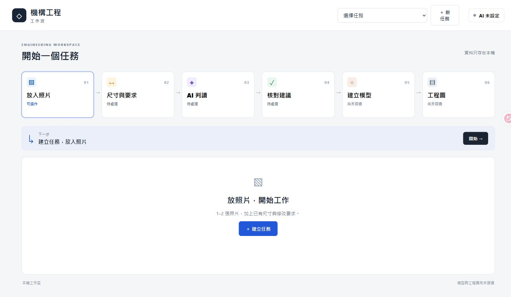

# Mechanical Engineering Workflow｜機構工程視覺工作流

A local, visual workspace for collecting photos, dimensions and change requirements, preparing a bounded AI handoff, and reviewing structured suggestions.

**Version 0.2.0 — phase delivery, feature development stopped at this snapshot.**

**目前是前段工作流工具，不是完整的照片轉 CAD／工程圖服務。** 收件、保存、資料包與回覆核對可用；真實雲端模型、照片工程建模及工程圖產出尚未驗收。



## 使用方式

六個矩形節點以箭頭連接，滑鼠移入或鍵盤聚焦可看短說明，點擊開啟工具；下一步固定顯示。

`照片 → 尺寸與要求 → AI 判讀 → 核對建議 → 模型 → 工程圖`

1. 建立任務，選擇同一物件的 1–2 張 JPEG／PNG。
2. 填寫已有尺寸、數據來源、修改目標與不可改項，保存。
3. 準備固定資料版本，先核對即將使用的照片與文字。可只下載本機 ZIP，不傳送。
4. 匯入符合契約的 JSON 回覆，核對來源、引用與缺少資料；「已讀」不代表工程核准。

模型與工程圖節點目前明示「尚未接通」，不會產生替代模型或假的完成檔案。

## Quick start｜本機啟動

Tested with **Python 3.11.14 + Pillow 12.0.0** on Windows. Node.js is optional and only needed for frontend tests. No FreeCAD, COLMAP, GPU, cloud account or prebuilt CAD is required to run the released workflow.

Windows PowerShell:

```powershell
py -3.11 -m venv .venv
.\.venv\Scripts\python.exe -m pip install -r requirements.txt
.\.venv\Scripts\python.exe -B -X utf8 -s -m app.workflow.server --open-browser
```

設定完成後可雙擊 `Start-Workflow.cmd`。工具只監聽本機 `http://127.0.0.1:8171/`；關閉服務後資料仍保存在此副本的 `private/workflow/`。若埠已占用，先確認是什麼程式，不要任意關閉其他服務。

Other systems with Python 3.11:

```sh
python3.11 -m venv .venv
.venv/bin/python -m pip install -r requirements.txt
.venv/bin/python -B -m app.workflow.server
```

非 Windows 環境未列為本次實機驗收通過。克隆倉庫不包含任何使用者任務、照片或引擎；開始時是空工作區。

## Optional API｜選用連線

本版提供 OpenAI Responses 接口；不預塞模型名稱、不讀取 ChatGPT／Codex 登入，也不把訂閱當 API 額度。模型必須由使用者選擇且符合影像與結構化輸出需求，實際可用性尚未驗證。

- 金鑰只留本機服務記憶體；關閉服務或清除連線即不再沿用，不寫檔或瀏覽器 storage。
- 設定不會呼叫 API。每次真正送出前，須確認本次照片、尺寸、要求、接收服務及可能費用。
- 固定資料版本最多一次 API 嘗試，不自動重試。輸出 Token／等待預算不等於金額保證；請在供應商帳戶另設可接受的限額。
- `store:false` 不等於零保存。請先閱讀[官方資料政策](https://developers.openai.com/api/docs/guides/your-data)，確認有權外傳；照片內容仍可能含機密。
- **本次只驗證假傳輸，沒有測試真實 API、模型品質或產生 API 費用。**

## What works / limits｜已做與邊界

| Capability | Status |
| --- | --- |
| Task create/save/reopen, photo intake, dimension/source records | Implemented |
| Frozen handoff ZIP, structured response validation/review | Implemented |
| Responses adapter, consent binding, one-attempt receipt | Implemented; fake-transport tests only |
| Photo → editable engineering CAD, modification executor | Not connected |
| Engineering drawings, AutoCAD/SOLIDWORKS interoperability | Not implemented / not validated |

一兩張照片不能證明隱藏結構、獨立零件、材料、公差或精確幾何；模擬尺寸、使用者數據與來源參照分開保留。JSON 合格不代表幾何正確，資料包下載不等於工程圖交付。

## Verification｜驗證

Published-snapshot checks: **43 Python tests, 13 frontend state tests**, JavaScript syntax check. All provider calls are blocked or replaced with fake transport; tests use temporary tasks and generated images. These are software checks, not manufacturing accuracy or independent human validation.

```sh
python -B -X utf8 -s -m unittest discover -s tests/workflow -p "test_*.py"
node --test tests/workflow/frontend-state.test.mjs
node --check app/workflow/web/workflow.js
```

[Scope and known limits](docs/STATUS.md) · [Release notes](docs/RELEASE_NOTES_v0.2.0.md) · [Public verification summary](docs/verification-summary.json)

## Repository scope｜公開範圍

Only the current workflow and its necessary shared image-intake helper are included. Earlier reconstruction/CAD experiments, engine installers, private images, manual masks, task history and raw local logs are **not** included. Their absence is intentional, not a claim that the full engineering pipeline is complete.

## Rights｜授權

This original project is **not offered under MIT or another general open-source software license**. A public repository does not grant such a license. See [LICENSE_INFORMATION.md](LICENSE_INFORMATION.md).

Third-party dependencies keep their own terms. Pillow's MIT-CMU notice is retained separately in [THIRD_PARTY_NOTICES.md](THIRD_PARTY_NOTICES.md); it does not license this project's original code.
